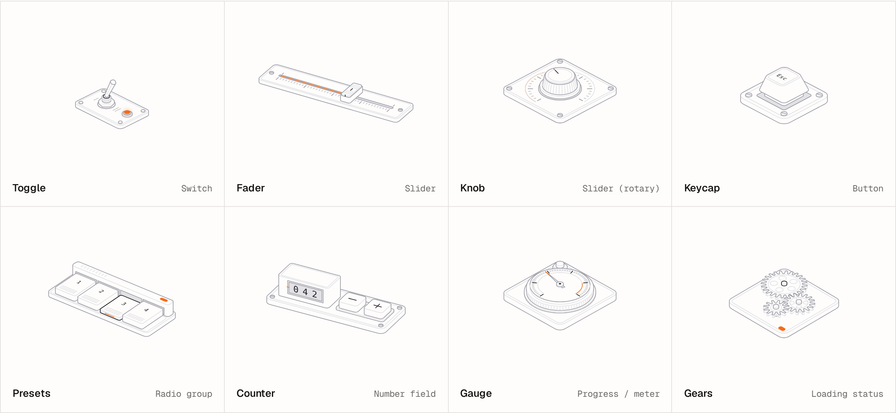
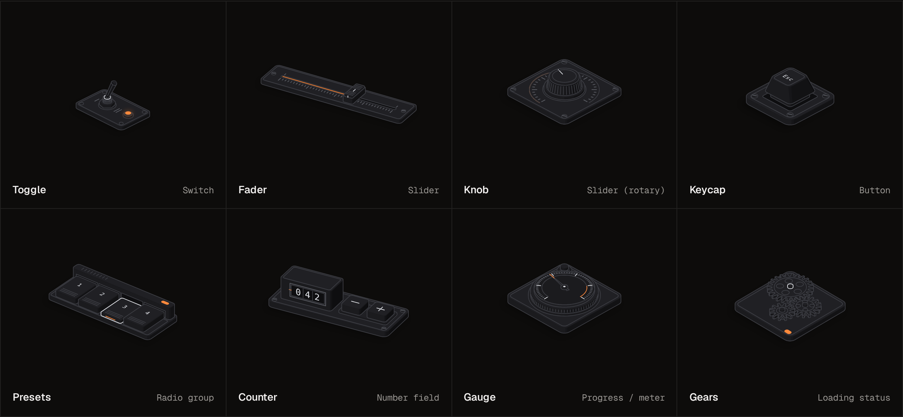

# Knurl

Form controls, machined. A switch is a toggle on a panel, a slider is a fader on its strip, a progress bar is a dial gauge. Eight accessible controls for React and any DOM, drawn as working isometric objects over native inputs. No dependencies.

[](https://www.npmjs.com/package/knurl-ui)
[](https://github.com/in-c0/knurl/actions/workflows/ci.yml)
[](./LICENSE)



Every control live, with its code: **[in-c0.github.io/knurl](https://in-c0.github.io/knurl)**

## Install

```sh
npm i knurl-ui
```

ESM only. React 18 or later is an optional peer, needed only by `knurl-ui/react`.

Or add a control's source to your project with the shadcn CLI. It writes the control and the shared core to `components/knurl`:

```sh
npx shadcn@latest add https://in-c0.github.io/knurl/r/toggle.json
npx shadcn@latest add https://in-c0.github.io/knurl/r/knurl.json   # all eight
```

## Use

### React

```tsx
import { Fader, Toggle } from "knurl-ui/react";

export function Mixer() {
  const [gain, setGain] = useState(60);
  return (
    <>
      <Toggle label="Mute" />
      <Fader label="Gain" value={gain} onValueChange={setGain} />
    </>
  );
}
```

A component renders one `<div>` at its own aspect ratio and draws on mount, so a server render reserves the space and nothing shifts. Pass `value` / `checked` to control it, or `defaultValue` / `defaultChecked`. It takes every `<div>` attribute and forwards its ref.

### Any DOM

```ts
import { gauge } from "knurl-ui";

const g = gauge(document.querySelector("#upload")!, { label: "Uploading" });
g.update({ value: 42 });
g.destroy();
```

`update` changes options on the running control (a key set to `undefined` goes back to its default); `destroy` removes only what the control added.

## The controls

| Component | Stands for | Built as | Underneath |
| --- | --- | --- | --- |
| `Toggle` | Switch | A bat-handle toggle on a panel. The lever snaps across on a stiff spring; a lamp lights when on. | `<input type="checkbox" role="switch">` |
| `Fader` | Slider | A mixing-desk fader. The cap rides a lit slot over a ruler whose ticks are the steps. | `<input type="range">` |
| `Knob` | Rotary slider | A knurled knob over a 270° scale. Drag up or down, scroll, or use the arrows. | `<input type="range">` |
| `Keycap` | Button | One mechanical key in a plate. It travels down and fires on release. | `<button>` |
| `Presets` | Radio group | A bank of latching preset keys: pressing one throws the last one back up. | native radios |
| `Counter` | Number field | A tally counter whose drums roll like an odometer, each carrying into the next. | `<input type="number">` |
| `Gauge` | Progress / meter | A dial gauge whose needle overshoots and settles; a tell-tale hand keeps the peak. | `role="progressbar"` / `"meter"` |
| `Gears` | Loading status | A 24 : 16 : 12 gear train that eases up to speed and coasts down. | `role="status"` |

### Options every control takes

| Option | Type | Default | |
| --- | --- | --- | --- |
| `finish` | `"line" \| "solid"` | `"line"` | Hairlines on plates, or four-tone shaded sides with lit lids and a contact shadow. Same geometry; the difference is CSS. |
| `theme` | `"auto" \| "light" \| "dark"` | `"auto"` | Follows `.dark` / `data-theme="dark"` on an ancestor, then `color-scheme`. |
| `label` | `string` | English default | The accessible name. |
| `disabled` | `boolean` | `false` | |
| `name` | `string` | | Form field name: the value submits with the surrounding `<form>`. |

Value controls (`Fader`, `Knob`, `Counter`) also take `min`, `max`, `step`, `onValueChange`, `onValueCommit` and `format` (for `aria-valuetext`). The per-control API is on the site.



## Theme

```css
.mixer [data-knurl] {
  --knurl-plate: #101014;   /* the colour the control sits on: plates are filled with it */
  --knurl-hi: #fafafa;      /* what is lit */
  --knurl-edge: #a1a1aa;    /* silhouettes */
  --knurl-mid: #52525b;     /* other strokes */
  --knurl-lo: #27272a;      /* what recedes */
  --knurl-accent: #f76b15;  /* the lamp, the lit slot, the red zone */
  --knurl-stroke: 0.9;      /* stroke width in CSS px, at any size */
}
```

The solid finish adds `--knurl-top`, `--knurl-s0` … `--knurl-s3` and `--knurl-shadow`. Every rule sits inside `:where()`, so any rule of yours wins without `!important`.

## Notes

- **Accessibility.** Each control is drawn over a visually hidden native input, button or ARIA role. Keyboard, screen readers and form submission are the platform's own; the focus ring follows the native element.
- **Motion.** Springs with real stiffness and damping. Under `prefers-reduced-motion` every spring lands in one step and the gears hold still.
- **Performance.** One `requestAnimationFrame` loop for every control on the page; a control offscreen or at rest does no work, and the loop stops when nothing moves.
- **Server rendering.** Nothing touches `window` at import. The React entry is a client module.

## Credits

Knurl stands on two MIT projects. [Anatomy](https://github.com/wheresryan22/anatomy) supplies the craft: invent the real object whose working is the idea, build it from many small precise parts, shade it in four tones. [Hairline](https://github.com/lucasmarkes/hairline) supplies the runtime: hairline figures that answer the pointer, a shared frame loop asleep offscreen, zero-specificity styles and a token theme. See [LICENSE](./LICENSE).

The docs site follows the patterns shared by the five fastest-growing component sites of the last year; the analysis is in [docs/RESEARCH.md](./docs/RESEARCH.md).

## Develop

```sh
pnpm install
pnpm dev        # the site, against the source
pnpm test       # unit tests (jsdom)
pnpm build      # the package, to dist/
pnpm site       # registry JSON + the site, to site/dist
```

## License

MIT
